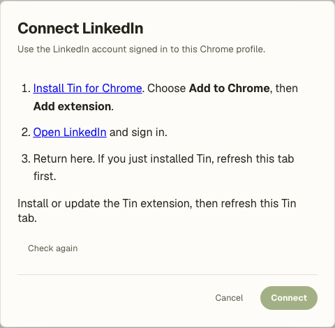
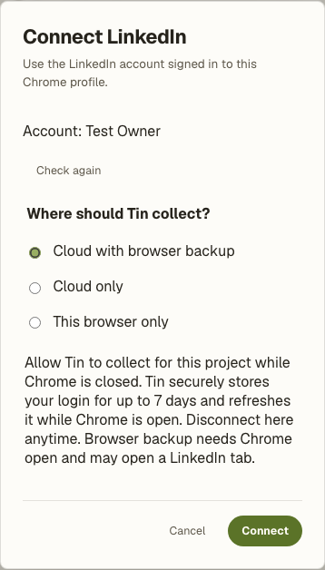
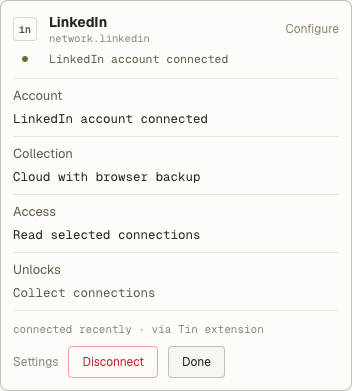
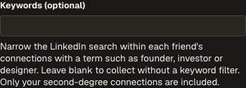

# Connection collection

`connections.collect` is a native workflow every project can run. It searches the member's
second-degree connections in one of two ways:
- **Their whole network** (no friends): one LinkedIn search, "Connections: 2nd", with an
  optional keyword query and an optional location. It runs in the cloud only; see
  [The whole network](#the-whole-network).
- **Through friends:** one to three LinkedIn profile URLs, each a visible first-degree
  connection, and an optional keyword query. Mutual first-degree connections are excluded.

Each person comes with their name, headline, location and the people you know in common, as
LinkedIn's card shows them ("X, Y & 12 other mutual connections"). The CSV lists the most
mutual connections first. This integration supplies reusable collection and export machinery.
Project-specific research and delivery belong in private packages.

## Set up a deployment

Apply migrations through the normal deployment process. Set
`TIN_LITE_LINKEDIN_EXTENSION_IDS` to the allowed Chrome extension IDs, comma-separated. The
list defaults to empty; without it LinkedIn can't be connected on this deployment.
Every project shows the card. Membership is checked again on every device operation and
publication. The account owner who paired the extension must start the collection.

## Connect once, then run from Tin

Choose **Integrations → LinkedIn → Connect**. The setup screen gives
three steps: install Tin for Chrome, sign in to LinkedIn in the same Chrome profile, and
return to Tin. It detects the extension version and account before enabling confirmation.
Users choose **Cloud with browser backup**, **Cloud only**, or **This browser only** once.
New workflow setup uses that choice as its default; existing saved workflows keep their mode.
Saving the choice does not report cloud setup complete until the session is verified. A
failed preparation stays in the setup dialog with a retry action. Connected accounts without
a visible name show a connected-account label, not another account-selection prompt.

Each member of a project connects their own LinkedIn. A project keeps one LinkedIn reading
connection per member (`integration_connections` allows one `network.linkedin` row per project
and member; every other integration stays one per project):
- Pairing Tin for Chrome replaces only that member's own connection and paired browser.
- A run collects or reads with the LinkedIn of the member who started it; a member who hasn't
  connected their own is asked to.
- Integrations, the LinkedIn card and MCP show each member their own connection, the saved
  choice fills their own new workflows, and disconnecting removes only their own.
- Deleting the project removes every member's connection.

The workflows that act through a member's own session are personal
(`connection_collection.personal`): this collection, [engagers](linkedin-engagers.md),
[profile viewers](linkedin-profile-viewers.md), [the connections export](linkedin-connections.md) and
[connection requests](linkedin-requests.md).
The project's ICP file and People stay shared; who runs them, and with whose LinkedIn, doesn't.
- **Saved copies are the saver's.** Only the member who saved one changes, pauses, resumes,
  skips, runs, retries or removes it, over HTTP or MCP (`owns`); anyone else gets "This uses the
  LinkedIn of the member who saved it". Each member keeps one saved copy of engagers, profile
  viewers and connections (`ONE_PER_MEMBER`). Collections, which take profiles to read, and the
  feed, which shows other posts later in the day, can be saved more than once.
- **A schedule runs as the member who saved it**, with their LinkedIn, as code schedules do. If
  they leave the project, the schedule pauses and says so; a current member saves their own.
- **My system shows each member their own** (Paper PW-A). Runs and saved workflows carry
  `personal` and `mine`; a teammate's personal ones stay out of your My system, the week
  calendar, the running counts (`get_project_system_summary(viewer=)`) and the MCP lists of
  runs and saved workflows. Activity keeps everyone's runs: a teammate's ends its line with
  "From Emre's LinkedIn." (`teammate`, a first name from their Tin account, or "a teammate"; no
  member ID reaches the browser).







The published extension must be updated to 0.4.2 for this screen. See the extension's
[installation guide](../browser-extension/README.md) and [store release](../browser-extension/STORE_RELEASE.md).
The setup page gives its five-minute, one-use pairing token an expected account and the
user's selected mode. The extension creates a device bearer locally and sends its hash.
The service records continuing permission only from this authenticated confirmation.
Earlier single-run transfers do not imply continuing permission.

Device bearers expire after 30 days and require current project membership. Reconnecting
invalidates the older device. Migration confirms retirement of this browser's legacy Tin
device through its existing endpoint before allowing collection. It does not sign out of
LinkedIn or change browser cookies. Settings can change collection permission for the same
account; selecting another account requires explicit pairing again.

Start the workflow through the dashboard or MCP run API. Enter full LinkedIn profile URLs,
separated by commas in the dashboard; names alone are not supported. Click **Manual run**.
The extension automatically claims queued work and refreshes cloud access as needed. The
popup can close; routine runs do not require a second click or a repeated permission prompt.
Local collection opens an inactive collection tab and needs Chrome open and awake.

Cloud choices remain visible when compute is unavailable. A cloud-preferred run can use
Chrome if the connection permits browser backup. A cloud-only connection pauses instead of
silently widening that permission. Pauses name the action needed in run progress.

Keywords narrow LinkedIn's search within each selected friend's connections. For example,
enter `founder` to target that term, or leave the field blank for no keyword filter.
The second-degree filter applies either way.



## The whole network

Leave the friends empty to search everyone LinkedIn counts as your second degree, the search
LinkedIn shows under People, Connections: 2nd.

- **Location.** A place such as `Istanbul` or `Germany`. On the first page, the cloud reader asks
  LinkedIn's public place search (the one its job search uses signed out, with no session) for
  its ID and pins the first match in the search (`geoUrn`). A place LinkedIn doesn't know stops
  the run with `location_not_found`. Location only narrows the whole network; with friends it's
  refused.
- **Cloud only.** Tin for Chrome searches a friend's connections and never claims a whole-network
  job. Local only is refused when the run starts. A cloud failure pauses the run instead of
  handing it to Chrome, and a run without cloud permission pauses before it starts.
- **Budget.** One search with the budget of all three friends from the run's pinned policy: 60
  pages, 600 people and the run's 45 minutes. LinkedIn itself shows at most about 100 pages of
  one search.
- **Scope.** The pinned search may hold only `network=["S"]`, the run's keywords and one
  location. A friend (`connectionOf`) or any other filter is `filters_changed`.

Every result card is read for its name (the link beside "• 2nd", never a link wrapping the whole
card), headline, location and mutual connections. People named in the mutual line are never
taken for the result. The CSV adds `mutual_count` (named plus "N other") and `mutual_names`
(the first named, up to three).

## Resume and limits

Each run pins its inputs and policy. Version 2 allows up to 24 hours waiting for Chrome
before the first collection attempt. The active budget starts once: three friends, 20 pages
and 200 people per friend, 15 minutes per friend and 45 minutes overall. Closing Chrome or
resuming does not reset these limits. Earlier version-1 definitions keep their original
45-minute deadline including waiting. An account lease prevents two active runs by the same Tin account owner from
collecting that observed account across projects. This is an observed account binding,
not proof of ownership of another person's LinkedIn account.

Long waits continue in a fresh Temporal history with the same run identifier. Preparation
recovers the existing Postgres job; this does not reset deadlines, accepted pages or permission.
The versioned workflow change replays the earlier collection history.

The worker persists each batch before uploading it. Postgres acknowledges the exact batch
before navigation. Duplicate acknowledgements, including the final page, are idempotent.
A new device attempt gets a new generation and lease; stale uploads are rejected. Visible
page identity, account, friend filter and all search filters must remain consistent. Repeated
pages, ambiguous pagination, unreadable results and hidden controls do not imply completion.
The adapter currently supports English desktop pages and semantic profile/search evidence.

Results are create-only files under `connections/<run-id>/`: a manifest, CSV and bounded
JSON chunks for people and friend paths. People are deduplicated while each observed friend
path remains available. CSV values are protected against spreadsheet formulas. Coverage is
explicitly limited to visible results; limits and interruption produce partial results.
Accepted pages survive disconnect and publication failure. Canonical publication uses the
project lock, expected HEAD and the shared lost-response reconciliation helper.

## Cloud candidate and local backup

The source includes a dedicated read-only HTTP adapter. It reproduces the published
extension's cookie allowlist, user agent, language and LinkedIn request context. It does not
launch a browser, run website JavaScript, follow authentication redirects, write cookies back,
or call a logout endpoint. The extension uploads this material after the user enables cloud collection during setup.
Chrome hands over every LinkedIn site's cookies, so the service keeps only what Chrome sends to
www.linkedin.com: a copy for another LinkedIn site (Sales Navigator, Learning,
business.linkedin.com) or for part of the site is left out, and of two copies it keeps the one
set for www.linkedin.com. A login it still refuses (`invalid_session`) is logged with the check
that failed and each cookie's name and domain, never a value, and the setup screen says so.
The trusted service checks the transferred account with one bounded read of `/voyager/api/me`
before reporting cloud access ready. Every E2B page checks it again.

**Which account it is.**
- Tin for Chrome names the account by the profile link in LinkedIn's header, or by its profile
  photo when the page shows no link (`avatar:` markers).
- A link or a photo can change; LinkedIn's member ID can't. So the first check also records the
  member ID from `/me` (`linkedin_session.member_id`) with the sealed session, and from then on
  the ID decides (`identity_matches`).
- When Tin for Chrome later names the account differently (a new photo or link), the save is
  accepted only if `/me` still answers with the recorded ID. The device, the permission and the
  sealed session then carry the new name. Another ID is `account_changed`, as before.
- A connection saved before the ID was recorded still matches by link or photo until its next
  save; after a new photo it needs one reconnect. Tin encrypts the session
with the existing integration cipher and binds it to the project, account,
permission and paired device. Retention is at most seven days, capped by the login-cookie
and device expiry; a session cookie without a declared expiry is kept for at most one day.
The extension refreshes access within a day of expiry while Chrome is open. To prepare a
refresh it may open LinkedIn's people search in a background tab, at most once a day; when
that page shows no search contract (LinkedIn's newer, server-rendered search), it drops the
contract it kept and saves the session without one. Before 0.4.5 a kept contract the page
no longer showed made every 30-second check refresh again, opening that tab each time. Raw
credentials never enter chat, MCP, Temporal history or project files.

A run pins the credential generation it uses. Disposable compute cleanup does not delete
continuing permission or a reusable session. Expired sessions, revoked devices and lost
membership are purged independently of workflow runs. Switching to browser-only clears the
session immediately and fences active cloud uploads; disconnecting uses the existing
integration revocation path. Old single-run transfers remain run-bound and are deleted on
finalization. Deleting the project removes its collection jobs, collected pages, leases and
devices. An account change or LinkedIn challenge requires attention, not an automatic
cloud/local retry.

Setup verifies and saves the login without requiring a search-query identifier. The current
image prepares each selected friend in cloud compute from the saved profile URL. It reads
profile metadata to bind the exact member, then checks the rendered profile for first-degree
relationship evidence and a connections link for that member. It reads the selected search
page with the pinned keyword and second-degree filters, using visible profile links,
relationship labels and pagination controls. It does not execute website scripts. The document adapter resolves unconditional atomic
visibility rules from bounded public stylesheets on `static.licdn.com`; those requests carry
no session headers or cookies. It supports this server-rendered contract, not arbitrary CSS
or client-only layouts. LinkedIn's newer pages follow `</html>` with rehydration scripts that
repeat the page as data; the adapter reads the document before them and refuses anything else
after it. A page may be up to 4 MB with those scripts. Unsupported or ambiguous evidence stops
rather than guessing.

Every page first verifies the authenticated account through `/voyager/api/me` with the same
explicit cookie header. Account identity does not depend on an avatar rendering in the page.
Unsupported profile or page evidence preserves the checkpoint and follows the existing
browser preparation or backup policy. A challenge or account change stops the run.

One friend never holds up the others. When the cloud can't prepare a friend, Chrome prepares
it only while Tin for Chrome is open (it checks in every 30 seconds; two quiet minutes count
as closed) and for at most ten minutes. Otherwise the run leaves that friend out with
`friend_not_prepared` in its coverage and goes on in the cloud with the next one. A friend who
isn't the member's first-degree connection is left out the same way, with
`friend_not_connected`, instead of pausing the run. A run that left a friend out ends partial,
and its summary names how many and why.

A friend the cloud couldn't prepare also records which check missed, as a finite `detail` in its
coverage (and in the worker's log when Chrome may still prepare it). The lookup found nobody
(`lookup_none`), several people (`lookup_many`), too much data (`lookup_too_large`) or only
another link's profile (`profile_link_changed`, a renamed profile); the profile had no member ID
(`no_member_id`) or name (`no_name`); or the page had no connections link
(`no_connections_link`), one for another member (`connections_link_other_member`), no heading
with the friend's name (`name_heading_missing`), two of them (`name_heading_repeated`), no
relationship badge (`no_degree_badge`) or several (`many_degree_badges`). Images built before
this send no detail.
The earlier GraphQL parser remains available for older pinned images; its query identifier
must come from an observed browser view. No cloud browser login screen is part of setup.

Cloud execution uses the existing `E2B_API_KEY` with a dedicated
`TIN_LITE_LINKEDIN_TEMPLATE`, `TIN_LITE_LINKEDIN_CLOUD_ENABLED=true` and the integration
encryption key. The optional `TIN_LITE_LINKEDIN_E2B_API_KEY` overrides the existing key
for operators who want a different account; it is not required. The old
`TIN_LITE_LINKEDIN_CLOUD_QUALIFIED` setting is accepted as a compatibility alias.
Enabling the runtime turns on cloud reading for every project; it does not assert that
live acceptance has passed.

Build only the collection image from the repository root:

```sh
python sandbox/linkedin/template.py --alias tin-linkedin-document-v1
```

The script accepts the existing E2B key and refuses ordinary Tin image aliases. Its
build context includes only the explicitly copied collection modules and runner, and
an import check runs inside the image. Existing Codex, isolated code, browser and Studio
templates and routing are unchanged. A separate Temporal activity queue
(`<base>-connections`, capacity 2) bounds collection work without occupying their worker
slots. The same E2B account still shares its provider quota; a separate image does not
reserve capacity. Check account headroom before expanding the pilot.

Before wider rollout, verify full pagination, matching cloud and DOM page boundaries,
correct identity, preserved normal-browser login through cleanup and later source checks,
and recovery after worker/sandbox interruption. Missing page numbers, ambiguous continuation
controls, hidden results and unsupported markup stop collection rather than imply completion.
Rebuild this dedicated image and set `TIN_LITE_LINKEDIN_TEMPLATE` to its new template ID.
Existing jobs retain their pinned image; create a new run to use the new adapter.

Execution policies are pinned for the run:

- `local_only`: Chrome performs the collection automatically when available.
- `cloud_only`: use the saved session; wait for Chrome if session refresh is needed, and let
  an open Chrome prepare a friend the cloud couldn't (see above). Results are collected in
  cloud compute; cloud failures pause.
- `cloud_preferred`: use the saved session. When the runtime is unavailable or a recoverable
  cloud failure occurs, continue in Chrome if the saved permission allows browser backup.
  Accepted pages, filters and cumulative limits are preserved. Cleanup must be confirmed
  first. The extension resumes automatically when awake with the correct account.

Challenges, rate limits, account changes and access denials pause rather than trigger a
handoff. Uncertain cleanup also pauses. No cloud retry silently creates another paid attempt.
Each page attempt has an effect receipt, bounded compute lifetime, network access restricted
to LinkedIn and its fixed public stylesheet host, root-only transfer files and usage/cleanup observations. Collection is Tin-funded
under its explicit connected-account billing policy; recorded supplier usage remains separate
from the zero customer charge. Missing supplier observations remain unconfirmed.

Cloud pagination and source-login preservation have not passed production acceptance. There
is no deployment, image build, provider configuration change or store release implicit in
installing this source.

### Engagement reads

The same image also reads who engaged with the member's own posts (#435), in
`linkedin_engagement.py`. The runner takes a packet `kind`:
- `search`, the default: one people-search page, as above, within 90 seconds;
- `linkedin_posts`: the member's own posts from their share feed
  (`/voyager/api/identity/profileUpdatesV2`, `q=memberShareFeed`), newest first, within a
  window and a limit. A plain repost names the original author, so it's left out; a repost
  with the member's own words is their post. Each post keeps its
  activity URN, the thread URN its reactions hang off, its date (from the activity ID), an
  excerpt and its counts;
- `linkedin_reactions`: one post's reactions (`/voyager/api/voyagerSocialDashReactions`
  with the post's thread URN), up to ten pages of ten from a given start, returning where to
  continue. Each person carries their LinkedIn profile ID, name, headline, connection degree
  and reaction. Pages and companies that react, and the member themselves, are left out. A
  post past 1,000 reactions is read to that point and marked capped.

An engagement read runs within five minutes. It starts with the `/me` account check and waits
a random 3 to 9 seconds before each page. Both reads are GET-only JSON on
`www.linkedin.com`, and LinkedIn's refusals map to the same reasons as collection.

The same image sends connection requests (#450), in `linkedin_invitations.py`:
- `linkedin_invite`: one request to one person, after `/me` and a fresh top-card read show
  neither a connection nor an invitation; the one POST, to a fixed path, without a note;
- `linkedin_relationships`: up to 20 people's relationship (connected, invited or neither), for
  who accepted.
See [Connection requests](linkedin-requests.md).

The same image reads who viewed the member's profile, in `linkedin_viewers.py`; see
[profile viewers](linkedin-profile-viewers.md):
- `linkedin_viewers`: up to ten pages of the profile-views list, from its start (with the
  overview, `GET /voyager/api/identity/wvmpCards`) or from the next-page request the last read
  handed back. The list pages are the page's own two read-only POSTs on `www.linkedin.com`
  (`/flagship-web/rsc-action/actions/server-request` and `…/pagination`), answered as React
  Server Components rows;
- `linkedin_profile_ids`: up to 20 public slugs' profile IDs and relationships, from the same
  profile read as `linkedin_relationships`.

The same image reads the member's home feed, in `linkedin_feed.py`; see
[LinkedIn feed](linkedin-feed.md):
- `linkedin_feed`: up to three pages of the feed (`GET /voyager/api/feed/updatesV2`, `q=feed`),
  from a start and the pagination token the last read handed back;
- `linkedin_feed_details`: for a few posts, the first page of comments
  (`GET /voyager/api/feed/comments` with the post's thread as `updateId`) and the first reactor
  pages, up to 24 requests.

The dash comment endpoints answer 400 to plain GETs, but the older `feed/comments` one answers
a plain GET with the post's thread (checked 25 November 2026), so comments need no query ID.

A new image with these reads needs a new `tin-linkedin-*` build and the template setting
changed; the search read is unchanged inside it.

## Verification

Use a disposable database for SQL contracts, never a configured customer database:

```sh
TIN_LITE_TEST_DATABASE_DSN=postgresql://... uv run pytest tests/test_connection_collection.py tests/test_connection_collection_setup.py tests/test_connection_collection_lifecycle.py
npm ci
node --test web/linkedin-setup.browser.test.js
npm test --prefix browser-extension
npm run test:collection --prefix browser-extension
```

The Chrome tests use synthetic pages and a local fixture backend. The cloud tests use mocked
provider responses and check the separate image, request context, single purchase, cleanup,
usage receipt, fencing and backup policy. Live acceptance is a separate operator action.
